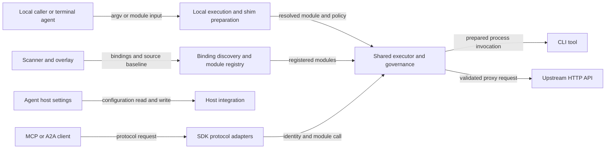

# Architecture Contract Remediation

| Field | Value |
| --- | --- |
| Status | Local fixes and OpenAPI SDK adoption verified. A2A 1.0 interoperability remains open. |
| Date | 2026-11-20 |
| Baseline | apexe 0.15.1 at `ce8a9f0e8fc5ed1208963493807fde8d89f4c7f1` with its committed `Cargo.lock` |
| Design inputs | Architecture review, repository contracts, locked SDKs, and isolated runtime checks |
| Implementation owners | apexe for execution, host configuration, and documentation. SDK owners for protocol and OpenAPI semantics. |

## 1. Decision

Repair each confirmed contract failure where its decision is made. For each code change, capture the incorrect observable result in a failing regression test and capture neighboring supported behavior in passing tests against the current release. Keep the existing interaction between scanner and overlay, shared executor, policy, and protocol adapters. Prefer the smallest change that passes both sets of tests. Documentation corrections can ship against verified current behavior.

The local defect fixes are independent of the protocol upgrades. Start the child-governance work with characterization tests and the resolved ACL handoff, then separately verify the approval and delegation lifecycle against the locked SDK. A2A interoperability and OpenAPI parameter loss are confirmed SDK defects. Each upstream change needs a focused compatibility review and a published version before adoption in apexe. Treat performance improvements and structural observations as backlog until a failing consumer contract or measured operational cost justifies implementation.

## 2. Deep Review Findings

**P0** blocks release of the affected behavior or claim until the stated condition passes. **P1** is a confirmed correctness or compatibility defect with its own patch and acceptance test. **Deferred** records a candidate with a trigger for future work. Priority describes release impact. The evidence column describes what has been established.

| Area | Evidence and consequence | Priority | Design and acceptance |
| --- | --- | --- | --- |
| Embedded child governance | Source review confirms separate ACL selection and an approval requirement that can be lost between child validation and execution. `x-apexe-approval-basis: flags` and `x-apexe-escalating-params` describe a ceiling evaluated against actual input. [Child preparation](../../src/cli/child_exec.rs) · [Annotation contract](../../src/adapter/annotations.rs) · [Approval gate](../../src/module/approval.rs) | P0 | §4.1 · AC-01, AC-02, AC-02D |
| Native route candidates | Clean baseline runtime confirmed the same harmless call chooses the subcommand with complete discovery and fails at the root with default loading. The unknown-token case currently contradicts the loader's candidate-preservation contract. [Loader](../../src/output/loader.rs) · [Matcher](../../src/adapter/argv.rs) | P0 | §4.2 · AC-04 |
| Host configuration | Clean baseline writes replaced existing MCP entries in both OpenCode and Claude project. The follow-up review also reports an OpenCode 2.3.0 host-level conflict where a later Shell allow overrode the effect of the generated edit. OpenCode documents last-match rule precedence. [Host writer](../../src/cli/agent.rs) · [OpenCode permissions](https://opencode.ai/docs/permissions/) | P1 for sibling entries and partial-write reporting. P0 for success with Bash still usable in an MCP-only setup. | §4.4 · AC-05A, AC-05B, AC-05C |
| A2A | Clean baseline Agent Card advertised JSONRPC 1.0. Authenticated `SendMessage` with `A2A-Version: 1.0` returned `-32601`. The observed legacy request got a result with an omitted or unsupported version header. [A2A tests](../../tests/a2a_integration.rs) · [JSON-RPC binding](https://a2a-protocol.org/v1.0.0/specification/#941-sendmessage) | P0 for interim disclosure and the 1.0 release claim. | §4.5 · AC-06D, AC-06 |
| OpenAPI | Clean baseline MCP discovery exposed the inline query parameter and omitted both the inherited and referenced parameters. Source review confirms the hazard checker reads operation-local inline parameters as well. [Import integration](../../src/openapi.rs) · [Path Item Object](https://spec.openapis.org/oas/v3.1.1.html#path-item-object) | P1 | §4.6 · AC-07A, AC-07B |
| Sandbox plan argv | Source review confirms sandbox dry-run appends the JSON switch after the existing planner already resolves the final argv. [Dry-run](../../src/cli/exec.rs) · [Planner](../../src/module/cli_module.rs) · [Execution I/O](../../src/module/io.rs) | P1 | §4.3 · AC-03A |
| Reviewed replay validity | Source review confirms the dry-run summary can omit a typed-path refusal from its overall validity, while execution enforces the refusal. [Dry-run](../../src/cli/exec.rs) · [Execution](../../src/module/cli_module.rs) | P0 | §4.3 · AC-03B |
| Operator documentation | Managed native and shims inherit stdin. Signal termination and sandbox scope vary by surface. The manual currently promises `128 + signal` for both exec modes. [Native tests](../../tests/native_exec.rs) · [Manual](../user-manual.md#47-apexe-exec) · [Capture](../../src/module/executor.rs) | P1 | §4.3 and §5 · AC-08 |
| Rust and scanner extensibility | Source review recorded structural observations with separate evidence triggers. [Path guard](../../src/governance/path_guard.rs) · [Verification evidence](../../src/verification/evidence.rs) · [Scanner cache](../../src/scanner/cache.rs) | Deferred | §4.7 |

The five runtime observations in §2.1 were rerun against the locked binary built from a clean archive of the stated commit. The earlier full quality gate ran on the reviewed worktree and is separate from these clean baseline results. The initial embedded-child policy and path-summary findings used source evidence. See [implementation evidence and open gates](#implementation-evidence-and-open-gates) for the current status.

### 2.1 Reproducible baseline observations

Build the committed baseline separately from the working tree. Keep the binary name `apexe` because the executable uses its invocation name to recognize shims.

```sh
baseline=$(mktemp -d)
git archive ce8a9f0e8fc5ed1208963493807fde8d89f4c7f1 | tar -x -C "$baseline"
(cd "$baseline" && cargo build --locked --bin apexe)
apexe="$baseline/target/debug/apexe"
```

Use an independent temporary working directory and HOME for each fixture, with environment overrides cleared. All operations below use dummy files, an inert tool or a local echo module. The OpenAPI check lists tools only. The A2A fixture needs permission to listen on loopback. The existing [OpenAPI example session](../../examples/openapi_import/demo.py) provides stdio request and A2A health helpers. The [runtime validation helpers](../../scripts/runtime_validation.py) provide a bounded HTTP client.

1. **Native route.** In the temporary directory create an executable `audittoy` that exits zero. In `bindings/`, create `cli.audittoy.binding.yaml` and `cli.audittoy.show.binding.yaml` using `spec_version: "1.0"` and one entry in `bindings` per file. The IDs are `cli.audittoy` and `cli.audittoy.show`. Targets are `exec://<absolute audittoy path>` and the same target followed by ` show`. Use command paths `["audittoy"]` and `["audittoy","show"]`. Both have `metadata.apexe_scan_format: 3`, `grammar: reviewed`, `variant: unknown`, and an authoritative `shim_contract` with variant `unknown`, `short_flag_bundling: true`, `cross_flag_ordering: false`, and `streaming_stdin_safe: false`. Mirror those capabilities as the corresponding hyphenated `x-apexe-*` input-schema keys. Set the input schema to an object with `additionalProperties: false` and a boolean property `verbose` carrying `x-apexe-flag: --verbose`. Add `x-apexe-flag-position: before-subcommand` to the subcommand's property. Use a plain object output schema and readonly annotations.

   Run `"$apexe" exec --dry-run --bindings-dir "$PWD/bindings" -- "$PWD/audittoy" --verbose show`. The default load exits 1 with an unexpected `show` operand on `cli.audittoy`. Repeat with `$HOME/.apexe/apcore.yaml` containing `version: "1.0"`, `project: {name: route-audit}`, and `bindings: {pattern: "cli.*.binding.yaml"}` on separate lines. The complete load selects `cli.audittoy.show` and reports `valid: true`.

2. **OpenCode project.** Write `{"mcp":{"existing":{"command":"echo"}},"tools":{"read":true}}` to `opencode.json` in the temporary project. Run `"$apexe" agent opencode --mcp-only --write` there. Inspect the resulting JSON. The server map contains only `apexe` and `tools.read` remains true.

3. **Claude project.** Write `{"mcpServers":{"existing":{"command":"echo"}},"tools":{"read":true}}` to `.mcp.json` in a separate temporary project. Run `"$apexe" agent claude --mcp-only --write` there. Inspect the resulting JSON. The server map contains only `apexe` and the unrelated root key survives. For either host fixture, a temporary default ACL with `rules: []` and `default_effect: deny` can be used when exercising a worktree version that requires an ACL for config generation.

4. **OpenAPI schema.** Use this local `openapi.json` with `"$apexe" serve --transport stdio --openapi "$PWD/openapi.json"`. Initialize the session and issue `tools/list`. Inspect the properties of `api.get_pets`. The recorded properties are `["inline"]`.

   ```json
   {
     "openapi": "3.1.0",
     "info": {"title": "Fixture", "version": "1"},
     "servers": [{"url": "http://127.0.0.1:9"}],
     "components": {"parameters": {"Shared": {"name": "referenced", "in": "query", "schema": {"type": "string"}}}},
     "paths": {"/pets": {
       "parameters": [{"name": "inherited", "in": "query", "schema": {"type": "string"}}],
       "get": {
         "operationId": "getPets",
         "parameters": [{"$ref": "#/components/parameters/Shared"}, {"name": "inline", "in": "query", "schema": {"type": "string"}}],
         "responses": {"200": {"description": "OK", "content": {"application/json": {"schema": {"type": "object"}}}}}
       }
     }}
   }
   ```

5. **A2A wire.** Place a single `cli.echo.binding.yaml` in `bindings/` with `spec_version: "1.0"` and one `cli.echo` entry targeting `exec:///bin/echo`. Give it the description `Echo fixture` and object input and output schemas with empty properties. Start `"$apexe" a2a --url "$url" --bindings-dir "$PWD/bindings" --auth token --auth-token architecture-fixture-token`, where `url` uses a free `127.0.0.1` port. Fetch `/.well-known/agent-card.json` using the test bearer token. POST the following JSON-RPC body to the advertised URL with `Content-Type: application/json`, the same bearer token, and `A2A-Version: 1.0`.

   ```json
   {"jsonrpc":"2.0","id":1,"method":"SendMessage","params":{"message":{"messageId":"fixture-1","role":"ROLE_USER","parts":[{"data":{}}],"metadata":{"skillId":"cli.echo"}}}}
   ```

   The baseline advertises `JSONRPC 1.0` and returns `-32601`. As legacy controls, use a fresh message ID for each `message/send` request, first with no version header and then with `A2A-Version: 99.0`. The baseline returns a result in both controls. Stop the temporary server after observing the responses.

## 3. System Context and Alternatives



| Decision | Recommended approach | Alternative and trade-off |
| --- | --- | --- |
| Route selection | Use complete discovery for ambiguous leading native options when the current inputs cannot prove the candidate set. | Namespace lookup can reduce I/O once a complete inventory is available. A matching filename prefix provides no such guarantee. The existing shim lookup is independent. |
| SDK defects | Repair the confirmed wire and parameter defects upstream, then test and lock the released versions in apexe. | A local adapter can release sooner but would require maintaining a second implementation of version selection or parameter resolution across SDK consumers. Correct the existing documentation while the upstream fixes are pending. |
| Host updates | Use the existing writer and validate the effective permissions of supported host versions. Refuse a conflict that the owned edit cannot resolve. | Reordering or deleting operator rules would change their policy. Multi-file transactions address a separate recovery problem. |
| Embedded execution | Carry the already selected policy into child preparation and reuse the gate for the actual approval decision. | Separate top-level child calls would change local command semantics and operator approval flow. The existing parent/child policy model already expresses the intended result. |

The design retains Rust 2021, Clap, Tokio, serde, apcore executor and registry, existing SDK protocol adapters, and file-backed configuration. The checked local toolchain is Rust 1.100.0. At the baseline, the lock selected `apcore` 0.33.0 for apexe, `apcore-a2a` 0.8.5, `apcore-mcp` 0.23.3, `apcore-cli` 0.14.0, and `apcore-toolkit` 0.14.2. It also contained `apcore` 0.32.3 through `apcore-cli`. This design adds no service or database. [Current dependency lock](../../Cargo.lock)

## 4. Detailed Design

### 4.1 Local governance and embedded child approval

Local preparation, shared executor assembly, and the existing approval gate own the changes. [Local setup](../../src/cli/local.rs) · [Child preparation](../../src/cli/child_exec.rs) · [Executor assembly](../../src/module/registry.rs) · [Approval gate](../../src/module/approval.rs)

1. Pass the local invocation's already selected ACL and caller into the existing child analysis. Preserve explicit selection, the shim manifest's policy, the local default, and intentional absence. A missing or unreadable selected policy takes the existing refusal path. Land this handoff separately from approval lifecycle work. Preserve default `refuse`, explicit `trust_uncovered`, and the established distinction between `analyze` and per-match `delegate`.
2. In `analyze`, include the child's effective approval requirement in the parent's preflight and in the existing local approval gate. A parent that would otherwise run without a prompt requests one human decision when the child requires it. The prompt identifies the child scope. Preserve explicit ACL approval and a flag-derived stand-down where the current gate permits it. The SDK preflight boolean can include the `x-apexe-approval-basis: flags` ceiling. Reuse the gate's actual-input evaluation of `x-apexe-escalating-params` and its conservative handling of ambiguous approval sources.
3. Keep delegation tied to authorized execution and scoped to the prepared invocation. When a human decision is required, require real approval before a grant becomes usable. Ordinary authorized calls keep their established prompt behavior. Dry-run and pre-execution refusal create no usable grant. Preserve the delegated shim's fresh ACL and path checks and verify it can apply the selected policy. A runtime timeout cleans up the grant while retaining the existing timeout result.
4. First test the smallest in-process implementation with the locked SDK. The existing `ApprovalGate` and `LocalApprovalHandler` can evaluate actual arguments and prompt on the controlling terminal. Add the parent-call requirement through the existing invocation and gate wiring, then check that it reaches both preflight and execution. Any SDK API proposal must name the specific typed input or lifecycle transition that cannot be expressed through those hooks and include a failing test. Keep PATH handling, command rendering, and grant storage outside the ACL handoff patch.

**Decision table for AC-01, AC-02 and AC-02D.** Parent and child requirements below are effective decisions for the actual arguments. A matched ACL approval requirement counts independently. A flag ceiling alone can stand down under the existing gate. Use the existing conservative gate decision if the approval source is ambiguous. The locked SDK's merged preflight boolean is an input to interpretation. A missing approval handler supplies no evidence of authorization. [Approval gate](../../src/module/approval.rs) · [Shim assembly](../../src/cli/shim.rs)

| Condition | Human prompts per invocation | `analyze` | `delegate` |
| --- | --- | --- | --- |
| Dry-run | 0 | Report coverage, policy and the interpreted approval requirement. Start neither process. | Same report and no usable grant. |
| Parent or child fails coverage, ACL or applicable path checks before launch | 0 | Refuse before either process starts. | Refuse before either process starts. No usable grant. |
| Both allowed. No effective parent, child or ACL approval requirement, including an inactive flag ceiling | 0 | Execute after ordinary authorization. | Execute through the child shim after ordinary authorization. Any scope information gives no authority to satisfy a later human approval requirement. |
| Parent alone, child alone, a matching ACL rule alone, or any combination requires approval. Human approves | 1 combined prompt | Start only after the decision. The prompt and parent preflight reflect the child requirement when present. | Make the grant usable only after the decision. Scope it to the approved invocation and children. Each matched child still passes fresh checks. |
| Approval is required and the controlling terminal is unavailable | 0 completed prompts | Refuse with the existing terminal remedy before either process starts. | Same refusal and no usable grant. |
| Approval is required and the human declines or the prompt times out | 1 prompt attempt | Refuse before either process starts. | Same refusal and no usable grant. |
| Policy or input changes at per-match evaluation, or approved execution times out | No extra routine prompt under the parent approval | Preserve the existing execution outcome and mode boundary. | Refuse a match whose fresh checks fail or whose effective approval requirement falls outside the completed authorization. Revoke the grant on timeout and preserve the timeout result. |

AC-01 uses a harmless child fixture whose explicit ACL and local default give opposite decisions in both directions. Assert the child's actual outcome follows the selected policy and caller. AC-02 and AC-02D use inert start markers and a controllable terminal or approval substitute. Assert prompt counts, real authorization evidence, whether either process starts, and grant usability at each lifecycle point. Check reports and audit records alongside those outcomes.

### 4.2 Binding discovery and route candidate equivalence

The binding loader owns discovery. The grammar matcher owns route selection. [Loader](../../src/output/loader.rs) · [Native preparation](../../src/cli/exec/native.rs) · [Shim preparation](../../src/cli/shim.rs)

- Fix the reproduced native case where a leading option leaves the subcommand unknown. The current loader has no inventory that proves coverage for that case, so use complete discovery with the effective SDK pattern. Keep the ordinary no-argument and known-subcommand paths and the independent shim manifest path. A future namespace shortcut needs a trustworthy inventory proving that every binding participating in the effective pattern, including multi-binding files and aliases, has been accounted for. Leave indexing outside this patch.
- Add a mixed layout with a conventional root file and a subcommand in a hand-authored or multi-binding file. Compare selected module ID, final argv and refusal or exit result with complete discovery over the identical binding set. With a policy denial on the selected child, assert that neither root nor child executes. Preserve existing ordinary root, known-subcommand, alias, configured-pattern, eligibility, shim and tombstone behavior. Measure the affected native path with a representative binding set before considering further optimization.

### 4.3 Prepared invocation and dry-run parity

`CliModule` owns argv and typed paths. The existing I/O and sandbox modules own spawn preparation. [CLI module](../../src/module/cli_module.rs) · [I/O](../../src/module/io.rs)

The duplicate JSON switch is confirmed in source. For AC-03A, feed the final argv produced by the existing planner to sandbox preview and compare it with argv recorded by an inert substitute actually launched through the affected execution path. Pin captured defaults, explicit overrides, conflicts and legacy switches separately. For AC-03B, preflight and execution use the same typed-path decision logic, with execution reevaluating live state. A denial produces a failed path check with its domain reason, `valid: false`, and the existing nonzero outcome. An earlier ACL denial still redacts paths and argv. Preserve literal replay, streams, timeouts and CLI output contracts. If either regression fails to reproduce against the committed baseline, record the fixture and actual result, then close or revise that item before a production patch.

Correct the [exec reference](../user-manual.md#47-apexe-exec) sentence that promises `128 + signal` for both modes. Passthrough uses `128 + signal`. Captured JSON uses `exit_code: -1` for a child with no normal exit code, and the Unix CLI process exposes that value as exit status 255. Keep the captured representation as a compatibility contract. An additive signal field can be considered when a real consumer needs it.

### 4.4 Host configuration edits

The `agent` host adapters own these edits. Use the existing writer and single-file replacement behavior. [Host integration](../../src/cli/agent.rs)

- Merge only the apexe MCP entry and the permission setting owned by the supported host adapter. Preserve sibling services, other permissions, unknown keys, file permissions, and the selected ACL. Invalid containers report their file and key before publication.
- The first OpenCode effective-permission target is **2.3.0**. Validate the host's V2 `permissions` rules for the `shell` action after project and user configuration are combined. The last applicable rule wins. Use the supported V2 setting for the owned Shell denial only when the proposed edit is unambiguous. If an operator rule conflicts, or precedence cannot be determined for the selected version and scope, refuse the automatic MCP-only write before publication and identify the conflict or missing version support with manual guidance. Preserve the operator's existing rules and allow explicit snippet output as guidance. Other OpenCode versions require their own effective-permission fixture before apexe reports MCP-only success. [OpenCode permissions](https://opencode.ai/docs/permissions/)
- For Claude Code, use the existing project and user scope behavior and verify `Bash` denial in the actual supported client. Start with the repository's documented test version, **2.1.318**, as a candidate. Claim MCP-only support for that exact version only after the runtime fixture passes. Each host fixture verifies it can discover and invoke a benign MCP tool. A harmless Bash invocation must be denied without launching its marker, including after a host restart or reload. Include non-conflicting and conflicting permission cases, plus invalid containers.
- Preserve the Claude user-scope workflow, including the printed registration command and the existing permission update for valid settings. Document the operator step and the automatic permission update. Changing that ordering requires a reproduced user-scope failure and a migration decision for users who depend on the current permission update.
- In Claude project scope, prevalidate both edited shapes before publication. Keep the server-registration-first order. Report a filesystem failure along with any completed write so an idempotent retry can read the current files. A new lock protocol, multi-file transaction, or shared writer abstraction needs its own demonstrated requirement.

### 4.5 A2A protocol interoperability

The `apcore-a2a-rust` dispatcher owns wire compatibility. apexe owns acceptance against the released SDK. Current Rust SDK clients send headerless `message/send`, expect a direct Task, and already send `A2A-Version: 1.0` for `ListTasks`. Capture those behaviors against the current server before adding the standard 1.0 path. The legacy traffic is a compatibility baseline. Full 0.3 interoperability requires independent evidence. [SDK call coverage](../../tests/a2a_integration.rs) · [A2A 1.0 specification](https://a2a-protocol.org/v1.0.0/specification/)

- **Immediate disclosure (AC-06D, P0).** Before the next release carrying the affected SDK, surface one operator-visible compatibility diagnostic on normal A2A startup with default logging and flags. Assert visibility at the default terminal or service output without an opt-in logging switch. Keep the diagnostic outside wire responses and qualify all user-facing 1.0 claims. Describe the verified legacy flow. The interim release still has a machine-readable Agent Card mismatch. AC-06 closes that mismatch. A replacement version requires verified wire compatibility for that version and card shape.
- Add the standard 1.0 request and response behavior in the SDK, including version selection and the specified unsupported-version error. Map the two wire shapes to the existing task operation. Preserve the working legacy method and response shape for existing callers. Test each capability that the interface advertises, including streaming where advertised.
- When changing the SDK client or Explorer, keep existing public Rust constructors and method result shapes compatible. An explicit versioned client path or internal wire adaptation can serve a caller that needs 1.0. Keep previously working server combinations working. Avoid automatic fallback that re-sends a task-creating request after ambiguous failure. Move existing examples only once their target server can serve the chosen version.
- Validate old SDK client against the new server, new client in its compatibility mode against the old server, and independent standard 1.0 requests against the new server. Include the old SDK's `ListTasks` request where supported. Verify authentication, denial semantics, and the Agent Card URL and version against the actual apexe CLI. Document the current compatibility limitation while the SDK release is pending. [A2A versioning](https://a2a-protocol.org/v1.0.0/specification/#36-versioning)

**Wire matrix for AC-06.** Read the actual Agent Card, use the advertised endpoint with an independent authenticated client, and verify the following requests and responses. Check advertised capabilities and their disabled controls. [JSON-RPC binding](https://a2a-protocol.org/v1.0.0/specification/#9-json-rpc-protocol-binding) · [Error mappings](https://a2a-protocol.org/v1.0.0/specification/#54-error-code-mappings)

| Request or card capability | Required wire outcome |
| --- | --- |
| Explicit `1.0` and `SendMessage` | Standard result containing `task` or `message`, with request ID preserved. A task-creating request with an ambiguous response is sent once. |
| Explicit `1.0` and `GetTask`, `CancelTask`, or `ListTasks` | Standard task replies and cancellation state. List results use `tasks` and spec pagination. Keep a fixture task in a working state long enough to retrieve, list and cancel that same task. Separately exercise the existing SDK's versioned `ListTasks` call. |
| Streaming advertised | `SendStreamingMessage` and `SubscribeToTask` return SSE with the correct JSON-RPC ID and standard event envelopes. Verify completion and the terminal-task subscription refusal. With streaming disabled, verify the protocol's unsupported-operation response. |
| Extended card or push notifications advertised | Test `GetExtendedAgentCard` and the advertised push configuration methods, with documented response shapes and authorization. Test the specified unavailable-capability outcomes where applicable. |
| Omitted or empty version and the supported legacy methods | Existing method names and result shapes remain usable, including direct Task for `message/send`. Identify this as the verified legacy flow. A full 0.3 claim requires separate conformance evidence. |
| Explicit unsupported version | Return `VersionNotSupportedError` with JSON-RPC code `-32009` and the matching request ID. The request performs no task operation, including when the request uses a legacy method name. |
| Missing credentials, denied caller, unknown method | Assert each distinct outcome and the expected absence of an upstream task action. |

### 4.6 OpenAPI parameter normalization

`apcore-toolkit-rust` owns effective parameter resolution and proxy preflight. `apcore-cli-rust` delegates its effective diagnostics to the toolkit and retains its legacy detector for existing callers. apexe uses the toolkit validator for startup registration and operator diagnostics. [Import](../../src/openapi.rs) · [OpenAPI guide](../openapi.md) · [OpenAPI Path Item specification](https://spec.openapis.org/oas/v3.1.1.html#path-item-object)

1. Record the baseline for existing inline path/query parameters and JSON request bodies. Preserve published module IDs, supported request serialization, tag and prefix filters, credential separation, and existing schema and ACL refusals before upstream I/O.
2. Resolve path-level parameters and same-document Parameter Object references for the already supported path/query subset. Apply operation overrides by `(name, in)`. Use that result for schema generation and forwarding capability checks. Keep public SDK entry points compatible. A newly visible required field changes the generated tool schema by design. Call out affected specs and the required caller input in release notes.
3. Preserve the startup refusal for query parameters on body methods, including inherited and referenced cases. The tool model flattens names, so compare effective inputs by external field name across path, query and the JSON body. For a selected operation, reject any collision that cannot be expressed and forwarded unambiguously. The diagnostic names the operation, field and conflicting locations. Cover same-name path/query and path/body collisions separately. Apply operation diagnostics after selection so excluded operations do not fail startup. Broader support for body-plus-query, new wire input shapes, headers, cookies, or serialization styles requires its own demand and compatibility review.
4. Check both the advertised schema and the request received by an isolated upstream. Confirm ordinary inline documents produce the same wire requests before and after. Treat the exact change from previously silent omission to visible input or explicit failure as part of the release contract.
5. Publish the toolkit resolver through an explicit SDK opt-in or additive API with existing scanner defaults preserved for old consumers. Then publish the matching CLI hazard-check update with a minimum toolkit version that includes the resolver. Keep the legacy `detect_proxy_hazards` signature and behavior for existing callers. The apexe change selects the new schema and hazard behavior together and records the tested pair in the lock. This is an SDK integration decision and adds no user setting.
6. Test a clean locked build and the documented source install in a fresh directory without using the repository lock. Also test that the previously published apexe with open lower bounds can resolve the newly available SDKs while retaining both legacy behaviors. For the new apexe, enforce compatible pair constraints, test resolution with the oldest supported and currently resolved pairs, and run the same upstream and startup assertions. If these combinations cannot be made safe, hold the default behavior change. A locked-only install for a new apexe release would need explicit approval and matching docs, and the older open-range consumers would still need the preserved SDK defaults. Include both crates in rollback. [Dependency constraints](../../Cargo.toml) · [Source installation](../quickstart.md)

### 4.7 Follow-on boundary repairs

These are observations with separate triggers. They carry no implementation commitment in this change set.

| Observation | Revisit when |
| --- | --- |
| Process-global path guard | A supported embedded caller needs independent policies or roots in one process and a fixture shows the existing construction contract cannot meet that need. [Path guard](../../src/governance/path_guard.rs) |
| Binding and evidence dependencies | A regression shows that loading the same eligible binding yields different verification status or failure handling. A source dependency cycle alone does not establish a user-facing defect. [Loader](../../src/output/loader.rs) · [Evidence](../../src/verification/evidence.rs) |
| Verification source identity | Revisit if a verification fixture shows a wrong provenance verdict for a supported embedding scenario. Preserve published module IDs and evidence semantics. [Verification](../../src/verification/drift.rs) |
| Rust API surface and dependency constraints | A supported consumer exhibits a resolution failure or loses type compatibility, or an upstream upgrade demonstrates a real blocker. Preserve existing SDK public types and targeted lock changes while adopting protocol fixes. A duplicate internal dependency or unbounded range alone does not justify tightening every dependency or reshaping public APIs. [Library exports](../../src/lib.rs) · [Dependencies](../../Cargo.toml) |

## 5. Operation and Documentation Contracts

Make the [User Manual](../user-manual.md) the owner of the execution surface matrix. It shall distinguish these current defaults and link each exception to its owning section.

| Surface | Coverage and policy | Child I/O and timeout | Approval and sandbox |
| --- | --- | --- | --- |
| Native reviewed | Reviewed route with the selected local ACL when configured | Inherited stdin and streams with passthrough environment rules and `local_timeout`. Unix signal exit uses `128 + signal`. | Local terminal approval where required. Sandbox for selected local modules. |
| Shim reviewed, scanned, or legacy | Installed manifest and route-tier policy with the manifest-selected local ACL | Inherited stdin and streams with passthrough environment rules and `local_timeout`. Unix signal exit uses `128 + signal`. | Local terminal or valid scoped delegation. Sandbox for selected local modules. |
| Explicit unmanaged passthrough | Explicit unmanaged selection under the applicable ACL. Schema-based argument path checks are unavailable. | Null stdin and passthrough outputs with passthrough environment rules and `local_timeout`. Unix signal exit uses `128 + signal`. | Existing unmanaged refusal or approval semantics. Sandbox selection applies through the synthetic unmanaged module ID. |
| Module JSON CLI | Registered module schema and applicable local ACL | Null stdin, captured output, and scrubbed environment with `default_timeout`. Signal termination uses the captured sentinel. | Captured execution cannot elicit terminal approval. Selected local module sandbox configuration applies. |
| MCP or A2A CLI modules | Registered and filtered modules with the server ACL when configured | Null stdin, captured output, and scrubbed environment under configured execution timeout and transport limits. Signal termination uses the captured sentinel. | MCP needs configured approval and a capable client or store. A2A CLI has no interactive approval. A2A library can supply a store. Local subprocess sandbox selection applies only to the local execution entries in this table. |
| Imported HTTP | Selected OpenAPI operation, shared executor and configured ACL | HTTP request and proxy deadlines with a transport result envelope. No subprocess streams or exit signal. | Same respective protocol approval rules. Local process path guard and sandbox do not apply. |

Passthrough inherits the environment subject to the local denylist. Captured mode starts with a scrubbed environment and uses the existing allowlist, with shim entries removed from PATH. The defaults are zero for `local_timeout` (no local deadline), 30 seconds for `default_timeout`, and 300 seconds for the separate A2A task timeout. [Process spawn](../../src/module/executor.rs) · [Config defaults](../../src/config.rs)

The guides own behavior specific to their scope.

- The [Threat Model](../threat-model.md) explains stdin as a separate trust boundary and references the matrix. [Sandboxing](../sandbox.md) owns backend scope, capability, and enforcement semantics. Preserve the overlay assertion as metadata where it remains part of the declared binding contract.
- The [Agent Shell guide](../agent-shell.md) owns per-host merge scope, manual steps, retry, and compatibility. The [OpenAPI guide](../openapi.md) owns the supported subset and startup diagnostics. The A2A section of the User Manual shall use an authenticated, runnable example matching the currently supported wire contract.
- Keep audit correlation and established error envelopes. Report layer, outcome and existing identifiers without arguments, secrets or full host configuration. Use existing retry and circuit-breaker policies. Deterministic configuration, policy and specification failures require correction before retry.

## 6. Implementation and Acceptance

Keep patches independently reviewable and reversible. Baseline fixtures, the AC-01 ACL handoff, verified documentation corrections, and AC-06D can proceed independently. Before approving production changes to approval, delegation, native routing or host permissions, agree on and exercise the relevant baseline controls and failure fixtures. The corresponding P0 must pass before release. Integrate A2A and OpenAPI SDK upgrades separately. Section 4.7 remains deferred.

### Acceptance scenarios

1. **Local governance operator (human).** The operator dry-runs a reviewed fixture, reviews its approval requirements, then authorizes a run with a benign child. The dry-run creates no active grant, and the executed call records the selected route and the policy outcomes for parent and child. [Local governance](#41-local-governance-and-embedded-child-approval)
2. **Protocol client (agent).** The client discovers an authenticated A2A 1.0 interface, sends the versioned request, and receives a result with the standard task or message member. An MCP client lists an imported test operation and observes all supported parameters. An isolated upstream sees the intended input in the correct locations. [A2A design](#45-a2a-protocol-interoperability) · [OpenAPI design](#46-openapi-parameter-normalization)
3. **Host maintainer (human).** The maintainer applies apexe configuration to a temporary setup with an existing MCP server. The supported host discovers and invokes a harmless MCP tool while blocking a benign Bash launch. Both services remain after a repeat edit. A conflicting rule or malformed setting produces an actionable failure and leaves the prior config intact. [Host edit design](#44-host-configuration-edits)

### Work packages

| ID and priority | Owner and target | Acceptance |
| --- | --- | --- |
| **AC-01 P0** | apexe local governance. First ACL handoff patch. | Opposite explicit and default ACL outcomes prove actual child execution follows the selected policy and caller in both directions. Exercise shim selection and existing absence behavior. |
| **AC-02 P0** | apexe approval gate. After AC-01. | Run the `analyze` decision table. Assert prompt count and process start for parent-only, child-only, ACL-only and combined approvals, inactive flag ceilings, absent terminal, decline and timeout. A child-only requirement is also visible in parent preflight. |
| **AC-02D P0** | apexe delegation. After ACL and approval decisions agree. | Run the `delegate` decision table with benign substitutes. Verify grant usability only within the authorized scope, prompt count, real child start, per-match denial, and cleanup on timeout. |
| **AC-03A P1** | apexe dry-run argv. Independent preview patch. | Compare the sandbox plan with actual argv recorded by a launched inert substitute for captured JSON defaults, explicit overrides, conflicts and legacy bindings. |
| **AC-03B P0** | apexe dry-run validity. Independent preview patch. | A denied typed-path verdict yields a failed check with its domain reason, `valid: false` and a nonzero exit. Real execution refuses too. On an earlier ACL denial, neither paths nor argv appear in the result. |
| **AC-04 P0** | apexe native loader. First routing patch. | In both canonical and mixed layouts, the affected native call matches complete discovery in selected module ID, argv and execution or refusal result. A denied selected child produces no root or child execution. Existing root, known-subcommand, alias, pattern, reviewed eligibility, shim coverage and tombstone cases pass. [Native tests](../../tests/native_exec.rs) · [Shim tests](../../tests/native_shims.rs) |
| **AC-05A P1** | apexe host writer. Nested-merge patch. | OpenCode and Claude project edits preserve sibling services and unrelated keys. Repeating the update is idempotent. |
| **AC-05B P0** | apexe host adapter. Gate for reporting MCP-only success on each supported version. | The pinned OpenCode and Claude fixtures can call an MCP tool and the host denies Bash without running the marker. Conflicting precedence, unsupported version or invalid edited containers give actionable guidance and preserve destination bytes. Check both applicable config scopes. |
| **AC-05C P1** | apexe host reporting. Partial-write patch. | An injected second-file I/O failure identifies the earlier completed write and the failed file. A retry reads the existing state and can complete the edit. |
| **AC-06D P0** | apexe A2A startup and docs. Before the next release carrying the affected SDK. | With default startup output, observe one compatibility warning. User-facing 1.0 claims carry the caveat, and the existing legacy flow runs. The Agent Card interoperability gate remains open. |
| **AC-06 P0** | apcore-a2a SDK, then apexe. Before declaring A2A 1.0 compatibility. | The independent client passes the §4.5 wire matrix using the actual Agent Card. Verify legacy omitted and empty versions, the existing versioned SDK `ListTasks`, `-32009` on an explicit unsupported version, and the advertised streaming capabilities. |
| **AC-07A P1** | apcore-toolkit, then apexe with the paired SDK release. | In [OpenAPI integration tests](../../tests/openapi_integration.rs), inherited, referenced and overridden parameters appear in the schema and reach the correct upstream location. Existing inline requests retain their wire representation. |
| **AC-07B P1** | apcore-cli with the corresponding toolkit release. Adoption gate for AC-07A in apexe. | Selected body-method query and flat-name collisions refuse at startup with operation and parameter diagnostics. The same excluded operations leave startup healthy. Clean locked and unlocked installs pass the paired checks. The old apexe resolution cannot activate half the fix. |
| **AC-08 P1** | apexe owning docs. Can land against the verified baseline. | Extend [documentation consistency tests](../../tests/documentation_consistency.rs) to check the exec signal distinction, stdin and sandbox scope, and the A2A auth caveat. Runtime tests own the actual result and exit status assertions. The documented A2A example runs against its declared compatibility flow. Strict MkDocs passes. |

**Release evidence.** Keep the current green baseline and demonstrate the specific failing case before changing production behavior. For each patch, verify its regression and neighboring contracts alongside `make check` and strict MkDocs. Approval and failure scenarios use substitutes and temporary files. Use the [existing shim benchmark](../../scripts/benchmark_shims.py) if a patch reaches the shim hot path. Adopt an upstream SDK release after the affected wire checks and existing-client fixtures pass.

**Compatibility and rollback.** Preserve existing binding and ACL formats for the first packages. Host failures make partial outcomes explicit so the existing operation can be retried. Ship local fixes independently where they have separate acceptance. Restore the paired SDK bounds, lock and matching capability documentation together if an SDK adoption must be reverted. Treat governance contract repairs as prerequisites for a subsequent release of the affected behavior.

**Baseline and document ownership.** Keep the baseline identified by commit and lock rather than by the local worktree. The implementation PRs can reference this reviewed proposal and add their acceptance fixtures alongside each fix. Once accepted, link the proposal under Architecture and feature records in the [Developer Guide](../developer-guide.md). The User Manual remains the source for released behavior. Release tags and issue numbers are assigned by the owning maintainers when the work is scheduled.

**Decisions to revisit with evidence.** Section 4.7 records the triggers for structural work. A changed captured signal representation and a changed Claude user-scope setup flow each require evidence from affected users.

### Implementation evidence and open gates

- Local regression coverage includes opposite-ACL native child cases (AC-01), replay validity and sandbox argv (AC-03A/B), and mixed-layout leading-option discovery (AC-04). The latter compares the selected module, actual argv and ACL refusal against full discovery forced by an equivalent non-default glob.
- AC-02 and AC-02D use the same terminal gate. A real PTY exercises both modes with parent-only, child-only, combined and no-approval cases, including decline and prompt timeout. A delegated match validates the effective ACL fingerprint, caller, child binding and arguments. Only an actual positive terminal decision for that child can satisfy its approval gate. Grant inheritance is scoped to the spawned command, and runtime tests cover dry-run and refusal, timeout cleanup, and a custom shim directory with an explicit ACL.
- AC-05A/C cover sibling preservation and idempotent writes. The Claude project fixture injects a failure on the second file, checks that the first write is reported and the settings bytes are preserved, then retries successfully. [Host tests](../../tests/agent_shell.rs)
- AC-05B was exercised on macOS with OpenCode 2.3.0 and Claude Code 2.1.318, each in project and user scope with a deterministic loopback model. Both hosts invoked a read-only apexe MCP module. Fresh host processes rejected native Shell or Bash without running the marker. OpenCode refused a conflicting agent rule before publication and preserved the destination. Claude Code used the normal project MCP trust setting or the documented user registration command and ran in non-interactive `dontAsk` mode. Its configured Bash denial held with an explicit tool allowance. These results establish the pinned version and scope combinations exercised.
- An explicit `approval: required` ACL is a server startup precondition for an enabled approval backend. MCP and A2A check it before receiving requests. The MCP-only generator checks the same precondition before publishing a launch command. Annotation-only approval keeps its existing opt-in behavior.
- A warm-cache fixture showed that a custom parser could consume or replace a built-in result. Custom pipelines now skip the built-in cache because their plugin lists have no stable cache identity. The cache version also invalidates entries from before the separation.
- AC-06D covers the interim A2A warning and legacy documentation. The startup banner and generated token are published after listener binding. A failed assembly or bind retains the single JSON error envelope. The upgraded apexe build emitted one warning with default logging. AC-06 remains open. An independent HTTP check read the advertised JSON-RPC 1.0 interface and sent authenticated requests to that URL. Standard `SendMessage` returned `-32601`. Legacy `message/send` completed with an omitted, empty or unsupported `99.0` version, while versioned `ListTasks` still returned a result.
- AC-07A/B use the published toolkit 0.15.0 and CLI 0.14.1. The shared apexe OpenAPI importer scans effective inputs and preflights only the selected operations before proxy registration. The lock also adopts MCP 0.23.4 and resolves one apcore 0.33.0.
- The OpenAPI regressions failed against the previous lock and import path. The updated lock and a fresh source resolution both passed all nine [OpenAPI integration tests](../../tests/openapi_integration.rs). MCP discovery exposed inherited and referenced fields and reflected the operation's query override. The loopback API received the expected path and query values. Startup refused selected collisions and inherited query inputs on a body method. Excluding the affected operations allowed startup. The previous `rust/v0.15.1` source tag independently resolved the same published SDK versions and passed its eight existing OpenAPI integration tests.
- A clean source install without the repository lock produced a release binary in a temporary install root. The [OpenAPI example](../../examples/openapi_import/README.md) passed through both MCP and the authenticated A2A legacy flow with a protected remote specification.
